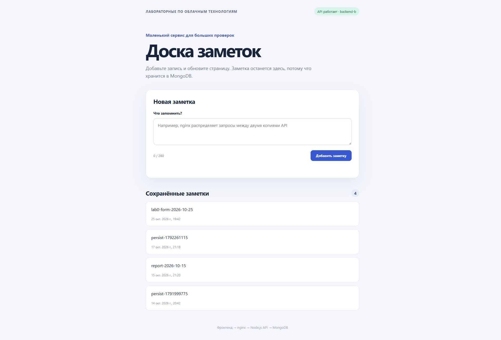

# Лаба 0. Сервис заметок

Для следующих лабораторных нужен сервис, который можно поставить за nginx, запустить в Docker и потом собирать в CI. Я взял за основу свой [template-server](https://github.com/stanevko-ilya/template-server). В нём уже был Node.js-бэкенд, поэтому оставалось добавить к нему простую полезную функцию. Сделал доску заметок: текст вводится на странице, сохраняется в MongoDB и появляется в списке. Код находится в [репозитории devops-labs-vot](https://github.com/stanevko-ilya/devops-labs-vot).

## Из чего состоит приложение

У приложения три части:

- Страница в каталоге [`frontend`](../frontend/) показывает форму и список заметок.
- Node.js API принимает запросы от страницы. Метод `POST /api/notes/add` сохраняет новую заметку, `GET /api/notes` отдаёт список.
- MongoDB работает отдельным сервисом. Заметки лежат в именованном томе `mongo-data`, а не внутри контейнера с приложением.

Связь такая: страница отправляет запрос на `/api/`, бэкенд обращается к MongoDB и возвращает ответ странице. nginx добавлен в следующей работе и сейчас раздаёт страницу с API по одному адресу. Настройки nginx и двух копий бэкенда подробнее описаны в [лабе 1](../lab1/REPORT.md).

## Что я менял

Сначала добавил [модель заметки](../modules/db/models/note.js). В ней есть текст и время создания. Текст обязателен, лишние пробелы обрезаются, длина ограничена 280 символами. Благодаря времени создания список можно выводить от новых записей к старым.

Потом добавил [метод записи](../modules/api/methods/notes/add/index.js) и [метод чтения](../modules/api/methods/notes/index.js). Первый проверяет текст и создаёт запись через модуль базы данных. Второй читает последние 100 записей. За счёт этого заметка не хранится только в памяти браузера или сервера: после нового запроса её можно получить из базы.

После этого сделал страницу [«Доска заметок»](../frontend/index.html) и её [скрипт](../frontend/app.js). При открытии страницы скрипт загружает список через `GET /api/notes`. Когда я отправляю форму, он вызывает `POST /api/notes/add`, очищает поле и запрашивает список заново. На странице также видны счётчик символов, время создания заметок и сообщение об ошибке, если API недоступен.

Для запуска всех частей одной командой добавил их в [docker-compose.yml](../docker-compose.yml). Команды запуска и основные адреса есть также в [README](../README.md).

## Как запускал

Сначала запустил Docker Desktop. Затем в каталоге проекта выполнил:

```bash
docker compose up -d --build
docker compose ps
```

После запуска страницу можно открыть по адресу `https://lab.localhost`. Сертификат для локального адреса самоподписанный, поэтому браузер может показать предупреждение. Оно связано с учебным сертификатом, а не с ошибкой приложения.

## Что получилось проверить

Чтобы проверить именно запись в базу, отправил заметку `report-2026-10-15` через API и два раза запросил список. В обоих ответах была эта заметка с одним и тем же `_id` — `6ad1196febac28d7efbf7405`. Полный ответ команд сохранён в [evidence/service-persistence.txt](evidence/service-persistence.txt).

```text
POST /api/notes/add → text: report-2026-10-15, _id: 6ad1196febac28d7efbf7405
GET /api/notes #1 → заметка есть в списке
GET /api/notes #2 → заметка с тем же _id снова есть в списке
```

После этого снова открыл страницу приложения. В списке осталась та же заметка `report-2026-10-15`; её видно на втором снимке. Это показывает, что страница получает сохранённые данные из базы и при новом открытии, а не только в момент записи. Снимки были сделаны позднее, после пересоздания контейнера MongoDB во второй лабораторной. Первый показывает форму и статус API, второй — сохранённые заметки.


Отдельно проверил саму форму: 25 октября ввёл `lab0-form-2026-10-25` в поле «Что запомнить?» и нажал «Добавить заметку». Страница показала новую запись в списке. Затем обновил вкладку: поле ввода очистилось, а заметка осталась в списке. После обновления вверху также отобразился `backend-b` вместо `backend-a`, так что страницу обслужил другой экземпляр API, но данные он получил из той же MongoDB.



## Итог

Получился небольшой сервис с формой, API и отдельной MongoDB. Проверил и запросы к API, и обычное добавление через форму: после обновления страницы записи остались. Этот сервис использовал в следующих лабораторных.
