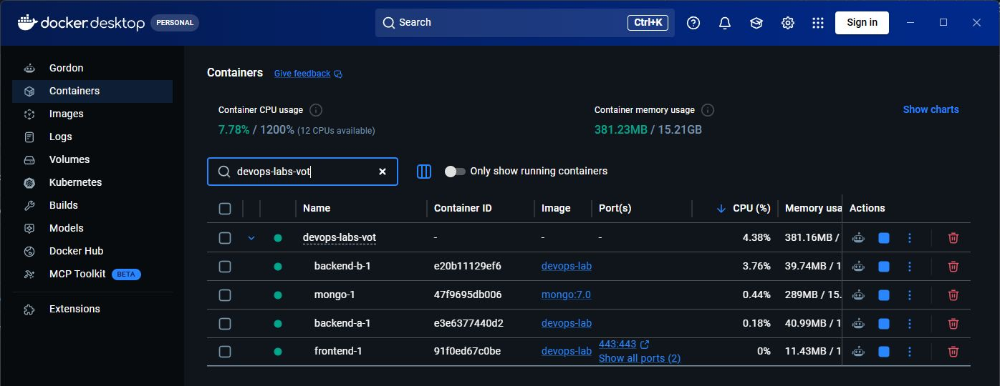

# Лаба 1. nginx перед сервисом заметок

В предыдущей работе я сделал сервис заметок с формой, API и MongoDB. Теперь поставил перед ним nginx. Он принимает запросы от браузера, отдаёт страницу и распределяет обращения к API между двумя копиями бэкенда. Главная проверка этой лабы — остановить одну копию и убедиться, что API всё равно отвечает. Как устроен сам сервис заметок, описано в [отчёте по лабе 0](../lab0/REPORT.md).

## Сначала поднял сервисы

В [docker-compose.yml](../docker-compose.yml) описаны четыре контейнера. `frontend` — это nginx со статической страницей. `backend-a` и `backend-b` запускают один и тот же Node.js-код, но слушают разные порты внутри сети Docker: 3000 и 3001. `mongo` хранит заметки. Бэкенды могут обращаться к MongoDB, а nginx к базе напрямую не подключён.

Для запуска из корня проекта использовал:

```bash
docker compose up -d --build
docker compose ps
```

После запуска в Docker Desktop видны контейнеры проекта. Зелёные индикаторы показывают, что они запущены.



На скрине видны `frontend`, `mongo`, `backend-a` и `backend-b`. У `frontend` наружу опубликованы порты 80 и 443, поэтому запросы пользователя сначала попадают в nginx. Остальные сервисы доступны по внутренним адресам Docker.

## Настроил HTTPS и маршруты

Конфигурация находится в [`docker/nginx.conf`](../docker/nginx.conf). Сначала добавил сервер на порту 80: он отвечает перенаправлением `301` на тот же адрес по HTTPS. Для локального стенда [скрипт запуска frontend](../docker/frontend-entrypoint.sh) создаёт самоподписанный сертификат. В настоящем публичном сервисе понадобился бы сертификат, которому доверяет браузер, но для этой лабы локального достаточно.

Дальше разделил страницу и API. Для обычных адресов nginx ищет файл в каталоге фронтенда и отдаёт его сам. Запросы с началом `/api/` он передаёт в `upstream api_backends`. Поэтому у страницы и API один внешний адрес `https://lab.localhost`, хотя внутри они обслуживаются разными процессами.

Ещё добавил `/docs/` через `alias`. Это отдельная папка с документацией: URL `/docs/` не совпадает с расположением файлов в основной папке сайта, и `alias` явно указывает nginx, откуда их читать. Проверочный скрипт запрашивает эту страницу и находит в ней текст про директиву `alias`.

## Добавил две копии API

В блоке `upstream api_backends` перечислил `backend-a:3000` и `backend-b:3001`. Оба подключены к одной MongoDB, поэтому список заметок одинаковый независимо от того, какая копия ответила. Чтобы проверить распределение запросов, бэкенд добавляет в ответ заголовок `X-Backend-Instance` со своим именем.

Я сделал шесть запросов к `/api/notes`. В выводе появились и `backend-a`, и `backend-b`. Это показывает, что nginx действительно направляет запросы на обе копии, а не просто держит второй контейнер без работы.

Для проверки отказа скрипт останавливает `backend-a` через `docker compose stop backend-a`. После этого три обращения к `/api/ping` всё равно вернули `200`: nginx направил их на работающий `backend-b`. В конце скрипт снова запускает остановленный контейнер. Именно это и было главным результатом задания.

## Добавил остальные правила nginx

Для второго доменного имени сделал отдельный простой сайт `other.localhost`. Он отдаёт другой HTML и заголовок `X-Site: other`. Если запрос приходит с неизвестным именем хоста, сервер по умолчанию отвечает `421`, чтобы не показать случайно сайт `lab.localhost`.

На `/api/` поставил `limit_req`: базовая скорость 5 запросов в секунду с небольшим запасом для короткого всплеска. Если отправить много запросов подряд, часть получит `429`. Это проверяется локально серией из 30 запросов.

Для неизвестной страницы настроил собственный файл `404.html`. Поэтому `/missing-page` возвращает код `404` и текст «Такой страницы нет». Путь `/admin` закрыл базовой авторизацией nginx: без имени пользователя и пароля ответ `401`. Файл с паролем создаётся при первом запуске frontend и хранится отдельно от исходного кода.

## Как проверял

Все проверки собрал в [`lab1/check.sh`](check.sh), чтобы их можно было повторить одной командой:

```bash
bash lab1/check.sh
```

Скрипт использует `curl --resolve`, чтобы направить `lab.localhost` и `other.localhost` на локальный компьютер без правки файла hosts. Для HTTPS в проверке добавлен `--insecure`, потому что сертификат самоподписанный. Это относится только к тестовому локальному адресу.

Получились такие результаты:

| Проверка | Что увидел |
| --- | --- |
| Открытие по HTTP | `301` на HTTPS |
| Несколько запросов к API | По очереди отвечали `backend-a` и `backend-b` |
| `/docs/` | Страница из отдельной папки открылась |
| `other.localhost` | Заголовок `X-Site: other` |
| Неизвестное имя хоста | `421` |
| `/admin` без пароля | `401` |
| Несуществующая страница | `404` и свой текст |
| Частые запросы к `/api/` | Среди ответов появились `429` |
| Остановка `backend-a` | API продолжил отвечать `200` |

Ниже оставил полную конфигурацию, сам скрипт и его фактический вывод. Для стартовой лабы 0 ещё нужен скрин страницы с сохранённой заметкой. В задании к этой лабе также просят скриншоты процесса настройки: сейчас есть снимок запущенных контейнеров, а снимок запуска проверки ещё нужно добавить.

## Конфигурация nginx

```nginx
limit_req_zone $binary_remote_addr zone=api_limit:10m rate=5r/s;

upstream api_backends {
    zone api_backends 64k;
    server backend-a:3000 max_fails=1 fail_timeout=5s;
    server backend-b:3001 max_fails=1 fail_timeout=5s;
}

ssl_certificate /etc/nginx/certs/lab.crt;
ssl_certificate_key /etc/nginx/certs/lab.key;
ssl_protocols TLSv1.2 TLSv1.3;

# Чужой Host не попадает ни в один проект.
server {
    listen 80 default_server;
    server_name _;
    return 421;
}
server {
    listen 443 ssl default_server;
    server_name _;
    return 421;
}

server {
    listen 80;
    server_name lab.localhost;
    return 301 https://lab.localhost$request_uri;
}
server {
    listen 80;
    server_name other.localhost;
    return 301 https://other.localhost$request_uri;
}

server {
    listen 443 ssl;
    server_name lab.localhost;
    root /usr/share/nginx/html;
    index index.html;
    add_header X-Site lab always;

    error_page 404 /404.html;
    location = /404.html { internal; }

    location / {
        try_files $uri $uri/ =404;
    }

    location /docs/ {
        alias /usr/share/nginx/docs/;
        index index.html;
    }
    location = /docs { return 301 /docs/; }

    location = /admin {
        auth_basic "Lab admin";
        auth_basic_user_file /etc/nginx/security/.htpasswd;
        try_files $uri =404;
    }

    location /api/ {
        limit_req zone=api_limit burst=5 nodelay;
        limit_req_status 429;
        proxy_pass http://api_backends;
        proxy_next_upstream error timeout http_502 http_503;
        proxy_next_upstream_tries 2;
        proxy_connect_timeout 2s;
        proxy_set_header Host $host;
        proxy_set_header X-Real-IP $remote_addr;
        proxy_set_header X-Forwarded-For $proxy_add_x_forwarded_for;
        proxy_set_header X-Forwarded-Proto https;
    }
}

server {
    listen 443 ssl;
    server_name other.localhost;
    root /usr/share/nginx/other;
    index index.html;
    add_header X-Site other always;

    location / {
        try_files $uri $uri/ =404;
    }
}
```

## Скрипт проверки

```bash
#!/usr/bin/env bash
set -euo pipefail

cd "$(dirname "$0")/.."

http=(curl --noproxy '*' --silent --show-error --resolve lab.localhost:80:127.0.0.1)
main=(curl --noproxy '*' --silent --show-error --insecure --resolve lab.localhost:443:127.0.0.1)
other=(curl --noproxy '*' --silent --show-error --insecure --resolve other.localhost:443:127.0.0.1)

echo '1. HTTP → HTTPS'
redirect="$("${http[@]}" -I http://lab.localhost/ | tr -d '\r')"
echo "$redirect" | head -n 5
[[ "$redirect" == *'301'* && "$redirect" == *'https://lab.localhost/'* ]]

echo '2. Оба экземпляра API'
seen=''
for _ in 1 2 3 4 5 6; do
  instance="$("${main[@]}" -D - -o /dev/null https://lab.localhost/api/notes | tr -d '\r' | awk -F ': ' 'tolower($1)=="x-backend-instance" {print $2}')"
  printf 'X-Backend-Instance: %s\n' "$instance"
  seen="$seen $instance"
  sleep 0.25
done
[[ "$seen" == *backend-a* && "$seen" == *backend-b* ]]

echo '3. alias /docs/'
"${main[@]}" https://lab.localhost/docs/ | grep -q 'директиву alias'
echo '/docs/: OK'

echo '4. Виртуальные хосты'
"${other[@]}" https://other.localhost/ | grep -q 'Второй проект'
other_headers="$("${other[@]}" -I https://other.localhost/ | tr -d '\r')"
echo "$other_headers" | grep -i 'X-Site: other'
foreign_status="$(curl --noproxy '*' --silent --insecure -o /dev/null -w '%{http_code}' --resolve stranger.localhost:443:127.0.0.1 https://stranger.localhost/)"
echo "Чужой Host: $foreign_status"
[[ "$foreign_status" == 421 ]]

echo '5. /admin без пароля'
admin_status="$("${main[@]}" -o /dev/null -w '%{http_code}' https://lab.localhost/admin)"
echo "/admin: $admin_status"
[[ "$admin_status" == 401 ]]

echo '6. Своя 404'
not_found="$("${main[@]}" -o /dev/null -w '%{http_code}' https://lab.localhost/missing-page)"
"${main[@]}" https://lab.localhost/missing-page | grep -q 'Такой страницы нет'
echo "/missing-page: $not_found, своя страница"
[[ "$not_found" == 404 ]]

echo '7. limit_req → 429'
flood=''
for _ in {1..30}; do
  code="$("${main[@]}" -o /dev/null -w '%{http_code}' https://lab.localhost/api/ping)"
  flood="$flood $code"
done
echo "Коды ответов:$flood"
[[ "$flood" == *429* ]]

echo '8. Останавливаем backend-a, API остаётся доступен'
docker compose stop backend-a
trap 'docker compose start backend-a >/dev/null' EXIT
sleep 2
for _ in 1 2 3; do
  code="$("${main[@]}" -o /dev/null -w '%{http_code}' https://lab.localhost/api/ping)"
  echo "При выключенном backend-a: $code"
  [[ "$code" == 200 ]]
  sleep 0.3
done

echo 'Все проверки лабы 1 прошли.'
```

## Вывод проверки

```text
1. HTTP → HTTPS
HTTP/1.1 301 Moved Permanently
Server: nginx/1.30.5
Date: Thu, 15 Oct 2026 18:19:14 GMT
Content-Type: text/html
Content-Length: 169
2. Оба экземпляра API
X-Backend-Instance: backend-b
X-Backend-Instance: backend-a
X-Backend-Instance: backend-b
X-Backend-Instance: backend-a
X-Backend-Instance: backend-b
X-Backend-Instance: backend-a
3. alias /docs/
/docs/: OK
4. Виртуальные хосты
X-Site: other
Чужой Host: 421
5. /admin без пароля
/admin: 401
6. Своя 404
/missing-page: 404, своя страница
7. limit_req → 429
Коды ответов: 200 200 200 200 200 200 200 200 429 200 429 200 429 200 429 200 429 200 429 429 200 429 200 429 429 200 429 429 200 429
8. Останавливаем backend-a, API остаётся доступен
 Container devops-labs-vot-backend-a-1 Stopping
 Container devops-labs-vot-backend-a-1 Stopped
При выключенном backend-a: 200
При выключенном backend-a: 200
При выключенном backend-a: 200
Все проверки лабы 1 прошли.
 Container devops-labs-vot-mongo-1 Waiting
 Container devops-labs-vot-mongo-1 Healthy
 Container devops-labs-vot-backend-a-1 Starting
 Container devops-labs-vot-backend-a-1 Started
```

## Итог

nginx раздаёт страницу по HTTPS, отдельно обрабатывает API и распределяет его запросы между двумя бэкендами. После остановки одного контейнера API продолжил отвечать. Остальные обязательные настройки тоже прошли проверку; задания со звёздочкой здесь не делал.
