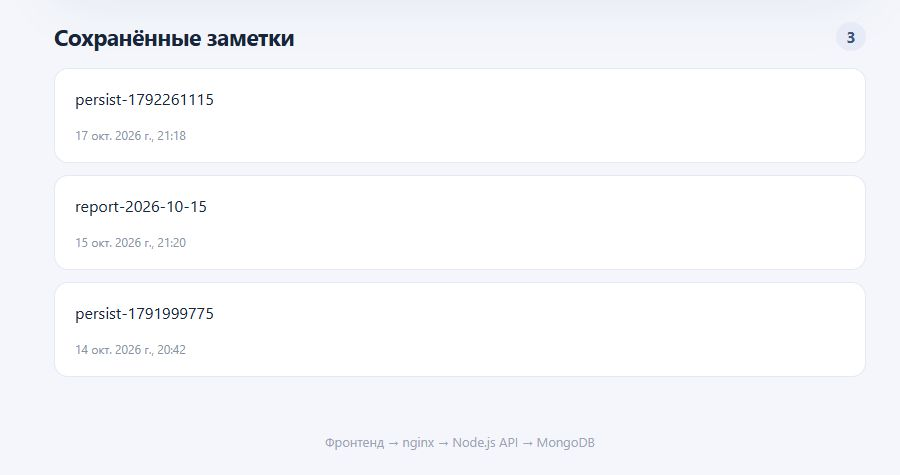

# Лаба 2. Docker

После лабы с nginx у меня уже был работающий сервис заметок. В этой работе я сравнил два способа собрать его в Docker-образ: специально неудачный и исправленный. Потом поднял весь сервис через Docker Compose и проверил пользователя внутри контейнера, сохранность заметки после пересоздания MongoDB и сетевую изоляцию.

## Сравнил два Dockerfile

В [`lab2/Dockerfile.bad`](Dockerfile.bad) оставил несколько проблем намеренно. Он использует плавающий тег `node:22`: при следующей сборке под ним может оказаться другая версия образа. Затем копирует весь проект до установки npm-пакетов. Даже правка одной строки кода сбивает кеш слоя с `npm install`. Пакеты ставятся вместе с зависимостями для разработки, приложение работает от `root`, а проверки здоровья контейнера нет.

В [хорошем Dockerfile](../Dockerfile) версия базового образа указана точно: `node:22.23.3-alpine3.24`. Сначала копируются `package.json` и `package-lock.json`, затем выполняется `npm ci --omit=dev`. Поэтому изменение исходного кода не заставляет npm ставить зависимости заново. Образ собирается в две стадии: из первой берутся установленные пакеты, а в итоговую попадают только файлы для запуска API. Вместо `root` процесс запускается от пользователя `node`. `HEALTHCHECK` обращается к `/api/ping` и позволяет Docker показать, готов ли сервис отвечать.

Ещё добавил [`.dockerignore`](../.dockerignore). Он исключает `.git`, локальные `node_modules`, тесты, `.env` и другие файлы, которые не нужны внутри образа. Это уменьшает контекст сборки и не даёт случайно положить локальные настройки в контейнер.

| В плохом образе | Как исправлено в хорошем |
| --- | --- |
| Плавающий `node:22` | Точная версия `node:22.23.3-alpine3.24` |
| `COPY . .` до `npm install` | Сначала файлы зависимостей и `npm ci`, потом код |
| Установка всех npm-пакетов | Только production-зависимости через `--omit=dev` |
| Запуск от `root` | `USER node` |
| Нет проверки готовности | `HEALTHCHECK` по `/api/ping` |

## Проверил размер и кеш сборки

Для сравнения написал [`measure-builds.sh`](measure-builds.sh). Он делает временную копию текущих файлов проекта, собирает оба образа, добавляет одну строку комментария в `modules/api/methods/ping/index.js` и пересобирает их. Рабочий код проекта при этом не меняется. В конце скрипт показывает время повторной сборки и размер каждого образа.

```bash
bash lab2/measure-builds.sh
```

В моём замере после изменения одной строки вышло следующее:

| Образ | Размер образа | Повторная сборка |
| --- | ---: | ---: |
| Плохой | 492 651 140 байт (492,7 МБ) | 33,982 с |
| Хороший | 67 954 800 байт (68,0 МБ) | 3,341 с |

Хороший образ получился примерно в 7,2 раза меньше, а эта пересборка прошла примерно в 10,2 раза быстрее. Это результаты одного запуска на моей машине, поэтому время на другом компьютере может отличаться. В [полном выводе замера](evidence/measure-output.txt) видно причину разницы: у плохого образа после `COPY . .` заново выполняется `RUN npm install`, а у хорошего шаг `RUN npm ci --omit=dev` остаётся в кеше. Пересобираются только слои с изменённым кодом.

```text
Плохой образ: RUN npm install → выполнен заново; real 0m33.982s
Хороший образ: RUN npm ci --omit=dev → CACHED; real 0m3.341s
bad=492651140
good=67954800
```

## Поднял сервисы через Compose

Перед проверками Docker Desktop один раз закрылся с ошибкой доступа к своему локальному сокету. После повторного запуска через Проводник Docker Engine заработал, и я смог собрать и поднять сервисы.

В [`docker-compose.yml`](../docker-compose.yml) есть `frontend`, две копии API (`backend-a` и `backend-b`) и отдельная `mongo`. Все запускаются одной командой:

```bash
docker compose up -d --build
docker compose ps
```

Фронтенд и бэкенды соединены сетью `edge`. MongoDB и бэкенды — сетью `data`. У `frontend` нет подключения к `data`, поэтому он не должен обращаться к базе напрямую. Данные MongoDB вынесены в именованный том `mongo-data`. Это важно: при удалении и создании нового контейнера база снова подключает тот же том.

Фактический список контейнеров после запуска сохранён в [compose-ps.txt](evidence/compose-ps.txt). На снимке ниже видны все четыре сервиса этого же стека. Они уже использовались в предыдущей лабе с nginx, поэтому конфигурация запуска общая для обеих работ.


## Проверил работающий стек

После запуска выполнил [`lab2/check.sh`](check.sh). Скрипт проверяет имя пользователя внутри `backend-a`. Затем добавляет заметку, останавливает и удаляет контейнер MongoDB, создаёт его заново и ищет ту же запись через API. В конце пробует из контейнера `frontend` подключиться к MongoDB на порт 27017. Для проверки используется установленный в контейнере `nc`, поэтому отсутствие самой команды не будет принято за сетевую изоляцию.

```bash
bash lab2/check.sh
```

Проверка закончилась без ошибок. Внутри API-контейнера команда `whoami` вернула `node`. У нового контейнера MongoDB другой ID, а заметка `persist-1792261115` после замены осталась в списке. Попытка соединения из `frontend` дала `nc: bad address 'mongo'`: фронтенд не видит имя базы в своей сети. Полный вывод лежит в [check-output.txt](evidence/check-output.txt).

```text
Пользователь хорошего образа:
node
Контейнер MongoDB заменён: 47f9695db006 → 952188551cc3
После пересоздания MongoDB запись persist-1792261115 найдена.
Сетевая изоляция frontend → mongo:
nc: bad address 'mongo'
Проверки лабы 2 прошли.
```

Открыл приложение в браузере после проверки. Вверху видно, что API отвечает через `backend-b`, а в списке сохранилась заметка `persist-1792261115`. Сделал два снимка одной страницы: верхней части и списка заметок, чтобы текст был читаемым.




## Файлы конфигурации

Плохой Dockerfile:

```dockerfile
# Учебный пример: намеренно плохой образ; не использовать для деплоя.
# 1. Плавающий тег, 2. root, 3. исходники до зависимостей, 4. dev-пакеты в runtime.
FROM node:22
WORKDIR /app
COPY . .
RUN npm install
EXPOSE 3000
CMD ["node", "index.js"]
```

Хороший Dockerfile:

```dockerfile
# Хороший образ: фиксированная версия, кеш npm, multi-stage и непривилегированный пользователь.
FROM node:22.23.3-alpine3.24 AS dependencies
WORKDIR /app
COPY package.json package-lock.json ./
RUN npm ci --omit=dev --no-audit --no-fund && npm cache clean --force

FROM node:22.23.3-alpine3.24
ENV NODE_ENV=production
WORKDIR /app
COPY --from=dependencies /app/node_modules ./node_modules
COPY --chown=node:node index.js notifier.js modules.js ./
COPY --chown=node:node functions ./functions
COPY --chown=node:node modules ./modules
RUN mkdir -p modules/logger/logs && chown -R node:node modules/logger/logs
USER node
EXPOSE 3000 3001
HEALTHCHECK --interval=20s --timeout=5s --start-period=20s --retries=3 \
  CMD wget -q -O /dev/null http://127.0.0.1:${API_PORT:-3000}/api/ping || exit 1
CMD ["node", "index.js"]
```

Файл Docker Compose:

```yaml
# Лабораторные 0–2: два API, nginx-фронтенд и отдельная MongoDB.
services:
    backend-a:
        build:
            context: .
            dockerfile: Dockerfile
        environment:
            API_PORT: '3000'
            INSTANCE_ID: backend-a
            DB_URL: mongodb://mongo:27017/labnotes
        depends_on:
            mongo:
                condition: service_healthy
        networks: [edge, data]

    backend-b:
        build:
            context: .
            dockerfile: Dockerfile
        environment:
            API_PORT: '3001'
            INSTANCE_ID: backend-b
            DB_URL: mongodb://mongo:27017/labnotes
        depends_on:
            mongo:
                condition: service_healthy
        networks: [edge, data]

    mongo:
        image: mongo:7.0.45
        volumes:
            - mongo-data:/data/db
        healthcheck:
            test: ['CMD', 'mongosh', '--quiet', '--eval', "db.adminCommand('ping').ok"]
            interval: 5s
            timeout: 5s
            retries: 20
        networks: [data]

    frontend:
        build:
            context: .
            dockerfile: docker/frontend.Dockerfile
        ports:
            - '80:80'
            - '443:443'
        volumes:
            - nginx-cert:/etc/nginx/certs
            - nginx-security:/etc/nginx/security
        depends_on:
            - backend-a
            - backend-b
        networks: [edge]

networks:
    edge: {}
    data:
        internal: true

volumes:
    mongo-data: {}
    nginx-cert: {}
    nginx-security: {}
```

## Итог

Хороший образ оказался меньше плохого и быстрее пересобрался после изменения кода. В Compose поднялись фронтенд, две копии API и MongoDB. API работает от обычного пользователя, заметка пережила пересоздание контейнера базы, а фронтенд не имеет прямого доступа к MongoDB. Часть задания со звёздочкой я не выполнял.
