# Лаба 3. CI/CD для сервиса заметок

В предыдущих работах я собрал сервис заметок, поставил перед ним nginx и упаковал бэкенд в Docker. В этой лабе проверяю, что GitHub Actions не выпускает образ с ошибками или критическими уязвимостями, а успешный образ публикует и запускает. Демонстрации делал последовательными коммитами в `main`: после каждого push GitHub сам запускал проверку. Исходные файлы — [хороший пайплайн](../.github/workflows/ci.yml), [плохой пайплайн](../.github/workflows/bad-ci.yml) и [Compose для деплоя](docker-compose.deploy.yml).

## Плохой и хороший пайплайны

В `bad-ci.yml` оставил учебный пример, который запускается только вручную. Он берёт плавающий `ubuntu-latest`, подключает `actions/checkout@v4` по тегу, делает `npm install` и собирает намеренно плохой Dockerfile из лабы 2. После сборки он ничего не проверяет и никуда не выкладывает образ. На нём видно, почему успешная команда `docker build` ещё не означает, что сервис можно выпускать.

Я [запустил этот workflow вручную](https://github.com/stanevko-ilya/devops-labs-vot/actions/runs/40215257665): `npm install` и сборка плохого образа завершились успешно за 37 секунд, но результата lint, тестов, скана или проверки живого сервиса в этом прогоне нет.

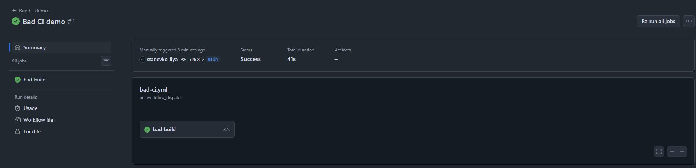

В `ci.yml` исправил эти места:

| В плохом пайплайне | В хорошем пайплайне |
| --- | --- |
| `ubuntu-latest` и тег `checkout@v4` могут со временем указывать на другое окружение и код экшена | Runner `ubuntu-24.04`, экшены закреплены полными commit SHA |
| `npm install` без проверки качества | `npm ci` по lockfile, затем lint и тесты с отдельной MongoDB |
| Нет кеша | `setup-node` кеширует npm, Buildx — слои образа |
| Собирается плохой Dockerfile, нет проверки CVE | Собирается хороший Dockerfile, Trivy считает HIGH/CRITICAL и останавливает выпуск при CRITICAL |
| Нет публикации и проверки сервиса | Образ с тегом SHA коммита отправляется в GHCR, запускается через Compose и проверяется `curl` |

Для публикации образа GitHub выдаёт запуску `GITHUB_TOKEN`; у этой задачи указано право `packages: write`. При скачивании публичного образа в проверках токен не нужен. Пароль или токен в YAML не записывал.

## Проверил, что плохой код не доходит до деплоя

Сначала я [добавил временный тест](https://github.com/stanevko-ilya/devops-labs-vot/commit/e69f0287f367213e7a111b035163496cd64dc618) с заведомо неверным ожиданием `expect(true).toBe(false)` и отправил его в `main`. Локально lint проходил, а этот тест падал. В [прогоне GitHub Actions](https://github.com/stanevko-ilya/devops-labs-vot/actions/runs/40216746289) получилось то же самое: 98 тестов прошли, один упал с `AssertionError: expected true to be false`. Задачи сборки, публикации и обоих деплоев были пропущены. Так я проверил, что ошибка теста останавливает выпуск до создания образа. В следующем коммите временный тест удалил.

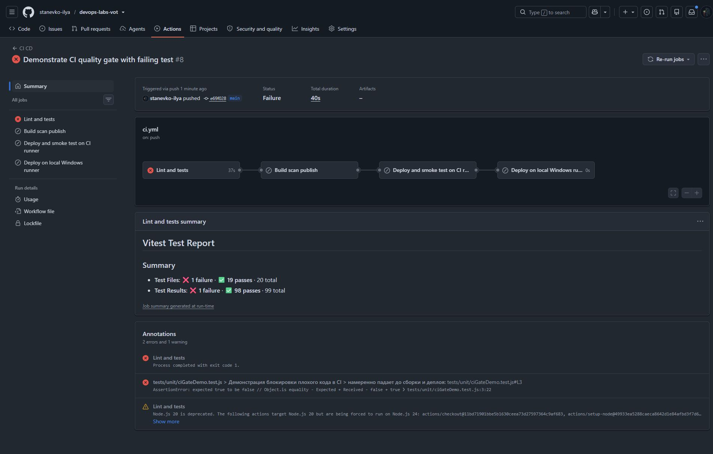

## Как проходит хороший пайплайн

При push в `main` или pull request сначала запускается `quality`: установка зависимостей, ESLint и Vitest. Интеграционные тесты получают MongoDB как сервис задачи. Если они падают, следующие задачи из-за `needs: quality` не стартуют.

Затем `image` собирает тот же хороший Dockerfile, который использовался в лабе 2. Trivy сначала записывает JSON-отчёт и выводит числа HIGH/CRITICAL, затем повторный запуск с `severity: CRITICAL` и `exit-code: '1'` служит блокировкой. Образ публикуется в GHCR только после успешного скана и только для `main`. Его тег — полный SHA коммита, поэтому проверка `deploy-smoke` скачивает именно проверенную версию.

После публикации `deploy-smoke` получает образ из GHCR, поднимает бэкенды, nginx и MongoDB через Compose на машине GitHub Actions и обращается к `/api/ping`. Успешный ответ подтверждает, что опубликованный образ запускается, но эта машина не является моим компьютером. Для локального деплоя есть отдельная задача `deploy-local` на Windows runner с меткой `vot-labs`. Она выполняется после проверки на машине GitHub, скачивает из GHCR образ с тегом полного SHA коммита и запускает его на моём ПК. Затем делает ещё один запрос к API. Пакет открыт для чтения, поэтому при скачивании токен не нужен.

Порты локального стека — 8080 и 8443, чтобы не занимать 80 и 443, которые уже использует стенд лаб 0–2. Это отдельный Compose-проект `vot-labs`, поэтому его контейнеры и тома не смешиваются с прежним стеком.

## Проверил старый базовый образ

После красного теста я убрал временный файл и [заменил только вторую строку `FROM` в Dockerfile](https://github.com/stanevko-ilya/devops-labs-vot/commit/7bfea549473b5540e80b2b4b97d2a79a7fcc6c83): итоговый контейнер стал собираться на `node:18.0.0-bullseye`. Этап установки npm-зависимостей оставил на Node 22, поэтому 98 тестов и сборка прошли. На сканировании Trivy показал `HIGH=3669` и `CRITICAL=294`. В логе также видно, что внутри старого образа Debian 11.3, для которого уже нет обновлений безопасности. Шаг `Security gate` упал, а публикация и деплой были пропущены.

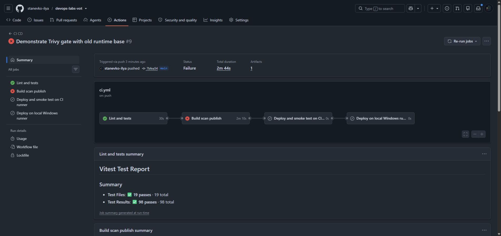

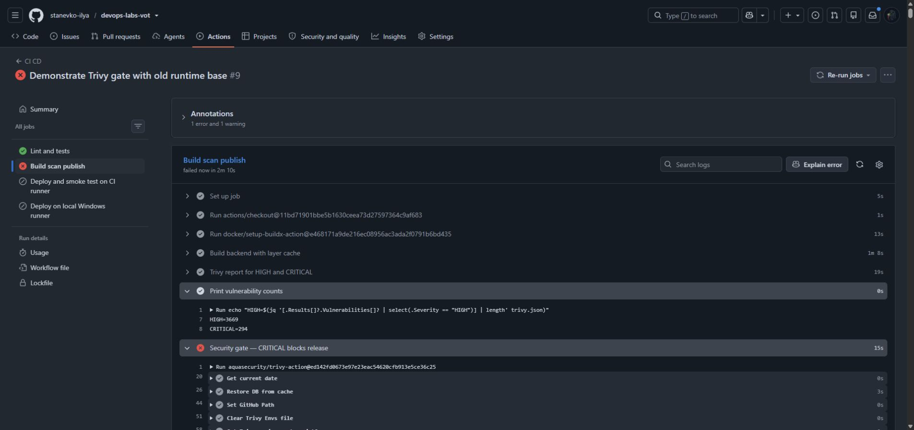

Затем я [вернул лёгкую базу `node:22.23.3-alpine3.24`](https://github.com/stanevko-ilya/devops-labs-vot/commit/fff03203c6d0e143d5ad2d97823592cae1248957). В [финальном сканировании](https://github.com/stanevko-ilya/devops-labs-vot/actions/runs/40218626861/job/121245248142) получилось `HIGH=20`, `CRITICAL=0`, после него образ опубликовался в GHCR.

| Итоговый базовый образ | HIGH | CRITICAL | Результат |
| --- | ---: | ---: | --- |
| `node:18.0.0-bullseye` | 3669 | 294 | Выпуск остановлен |
| `node:22.23.3-alpine3.24` | 20 | 0 | Скан пройден, образ опубликован |

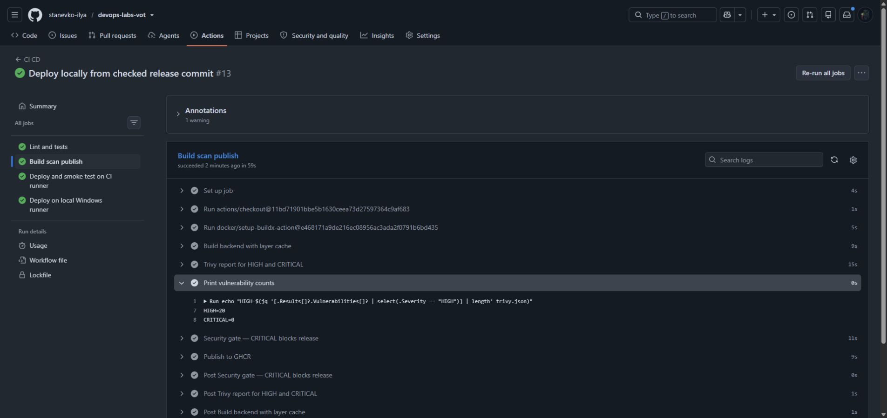

Разница получилась большой, потому что старый Debian-образ содержит намного больше системных пакетов с известными уязвимостями. Числа здесь относятся к конкретным прогонам 25 октября 2026 года: база CVE со временем меняется, поэтому при повторном запуске значения могут отличаться.

## Дополнительная проверка уязвимости в npm-зависимости

В [первом красном прогоне](https://github.com/stanevko-ilya/devops-labs-vot/actions/runs/38607346129) от 14 октября lint и тесты прошли, но Trivy нашёл `CVE-2026-90711` в `proxy-addr` версии 2.0.7. Шаг блокировки завершился с ошибкой, публикация была пропущена, деплой не запустился. В [следующем исправлении](https://github.com/stanevko-ilya/devops-labs-vot/commit/b176b08) обновил lockfile: версия `proxy-addr` стала 2.0.8, для которой эта CVE исправлена.

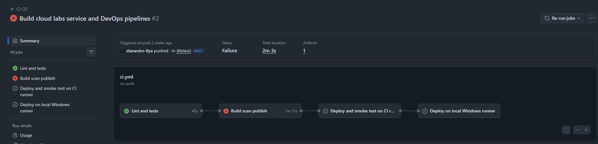

В [зелёном прогоне](https://github.com/stanevko-ilya/devops-labs-vot/actions/runs/40213662094) от 25 октября прошли lint, 98 тестов, сборка, скан, публикация и проверка сервиса на машине GitHub. В нём Trivy показал `CRITICAL=0`. В шаге проверки первый `curl` попал на ещё запускавшийся nginx и получил ошибку соединения; через две секунды повторный запрос вернул `{"response":{"ok":true}}`. Локальный Windows-этап в этом запуске был пропущен, потому что runner ещё не был зарегистрирован.

| Прогон | HIGH | CRITICAL | Что произошло |
| --- | ---: | ---: | --- |
| 14 октября, `proxy-addr` 2.0.7 | 19 | 1 | Security gate остановил выпуск |
| 25 октября, `proxy-addr` 2.0.8 | 20 | 0 | Образ опубликован и проверен на CI-машине |

Число HIGH стало на один больше, хотя CRITICAL исчезла: между сканами прошло 11 дней и база уязвимостей меняется. Я ориентируюсь на фактический вывод каждого запуска и отдельно показываю, что критическая проблема, остановившая первый выпуск, исправлена.

## Финальный прогон и запуск на моём ПК

Перед подключением Windows runner я проверил [Compose для деплоя](docker-compose.deploy.yml) локально: собрал код в образ `lab3-local:precheck`, поднял отдельный стек на 8080/8443 и запросил `https://lab.localhost:8443/api/ping`. Ответ был `{"response":{"ok":true}}`, оба бэкенда и MongoDB работали. Первые запросы могли получить 502, пока бэкенды стартовали, поэтому в CI проверка повторяется с паузой.

При первой настройке runner шаг не стартовал: на моём Windows не установлен `pwsh`. Я заменил его на обычный Windows PowerShell. Потом GHCR отклонил авторизацию локального runner, хотя задача на машине GitHub успешно скачивала опубликованный образ. Тогда пакет был приватным, и в первом успешном локальном запуске я собрал тот же коммит отдельно. Позже сделал [GHCR-пакет](https://github.com/stanevko-ilya/devops-labs-vot/pkgs/container/devops-labs-vot) публичным и проверил анонимный `docker pull`: образ с тегом `84934e8ee904e4e02737842b9cbff0bff5cd03b1` скачался без учётных данных. После этого изменил Windows-задачу: теперь она скачивает опубликованный образ по SHA и запускает его через Compose.

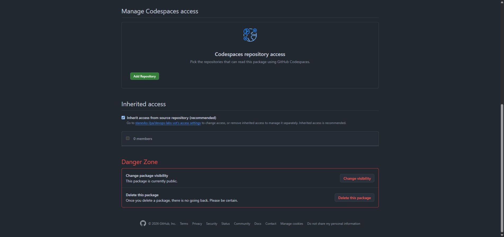

В [первом полностью зелёном прогоне](https://github.com/stanevko-ilya/devops-labs-vot/actions/runs/40218626861) от 25 октября прошли все четыре задачи: 98 тестов, сборка и Trivy, публикация и запуск образа из GHCR на машине GitHub, затем отдельная сборка и запуск того же коммита на моём Windows-компьютере.

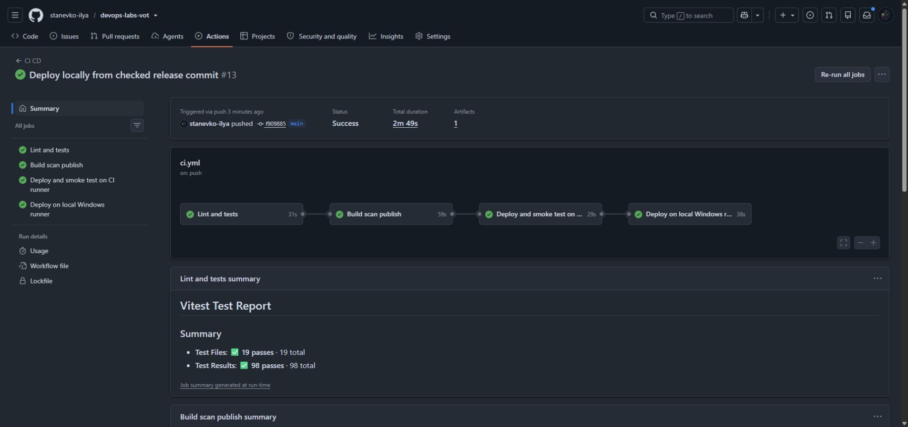

В [шаге `Check local service`](https://github.com/stanevko-ilya/devops-labs-vot/actions/runs/40218626861/job/121245613168#step:4:1) после нескольких 502 появился ответ `{"response":{"ok":true}}`. Там же видны два здоровых бэкенда, здоровая MongoDB и nginx на `127.0.0.1:8080` и `127.0.0.1:8443`. После завершения Actions я повторил запрос к `https://lab.localhost:8443/api/ping` прямо на ПК и получил тот же ответ. Самоподписанный сертификат для учебного локального стенда проверяю через `curl -k`.

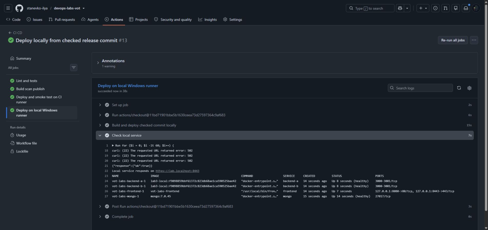

Runner был одноразовым и сам снялся с регистрации после задачи. Переменную `ENABLE_LOCAL_DEPLOY` я вернул в `false`, чтобы следующие push не ожидали неработающий runner. Локальные контейнеры оставил запущенными; они не затрагивают стенд предыдущих лабораторных.

После открытия пакета я запустил [новый полный прогон](https://github.com/stanevko-ilya/devops-labs-vot/actions/runs/40219997958). Все четыре задачи снова стали зелёными. В этот раз Windows runner [скачал из GHCR опубликованный образ](https://github.com/stanevko-ilya/devops-labs-vot/actions/runs/40219997958/job/121249926793#step:3:1) с тегом `e58a8fd4b9a0d89316fac3f07f4bcae1132496dd`, без авторизации в реестре. В логе виден digest `sha256:bfa61af6e72aff535c623361cc72a0711f10a11bd4d1a8457b75fa321b764645`.

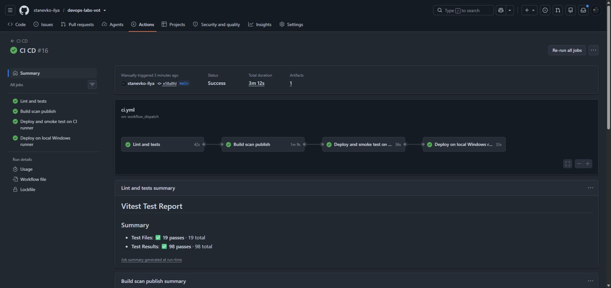

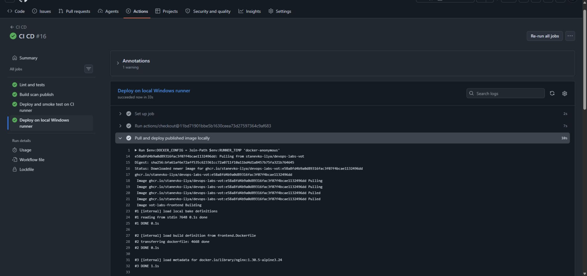

Шаг [Check local service](https://github.com/stanevko-ilya/devops-labs-vot/actions/runs/40219997958/job/121249926793#step:4:1) получил `{"response":{"ok":true}}` после короткого ожидания запуска бэкендов. В выводе Compose оба здоровых бэкенда работают на образе `ghcr.io/stanevko-ilya/devops-labs-vot:e58a8fd4b9a0d89316fac3f07f4bcae1132496dd`. После завершения Actions я отдельно проверил этот же тег через `docker compose images` и ещё раз запросил API на ПК — ответ был тем же. Runner сам снялся с регистрации, а `ENABLE_LOCAL_DEPLOY` снова установлена в `false`.

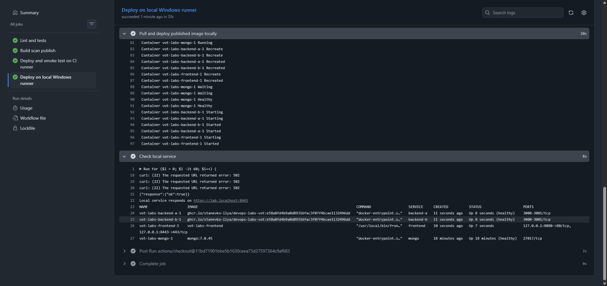

В итоге оба красных случая остановили выпуск до деплоя, а исправленный коммит дошёл до публикации, проверки на CI-машине и запуска того же опубликованного образа на моём ПК.
